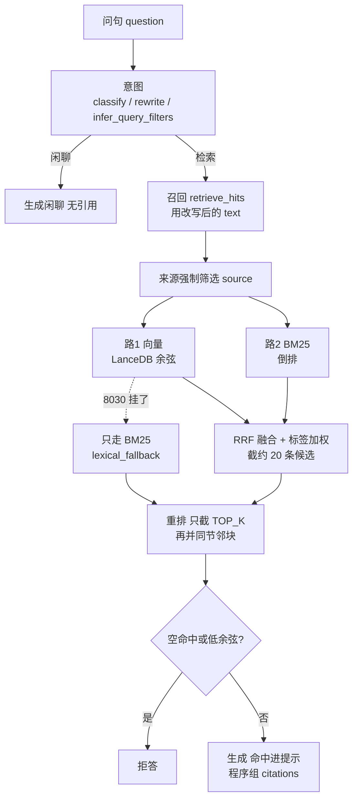

# 主流程实现细节

各层改代码时必须知道的判定、上限、字段落点。层与目录见 `architecture.md`。

## 1. 离线入库

人对库两步：`python scripts/ingest/extract_pdf.py`（不需要 8030）写出原始页；`python scripts/ingest/ingest.py` 从原始页做成可分块原文再写向量库（前提：`python -m service.embed.server` 已启动）。改完分块或标签只重跑 `ingest.py`，不重跑 pymupdf4llm。找不到 `raw_pages.json` 就失败，不回头抽 PDF。

只认 `SOURCE_ALLOWED_SUFFIXES`（本阶段 `.pdf`）；不在清单里的文件跳过并打日志。要跑哪几份，改脚本顶部 `PROCESS_ONLY`（空元组 = `backend/data/source` 全部）。

```text
scripts/ingest/extract_pdf.py
  PdfPageExtract.extract                                 # → raw_pages.json

scripts/ingest/ingest.py
  CatalogueBuild.build → TagEnrich.infer → ChunkableCollect.write
                                                         # → chunkable_source.json
  vector.entrance.run_vector
    chunk → POST 8030 → store                            # → backend/data/lancedb chunks 表
                                                         # 写库成功之后才写 step4_chunks.json
```

### 1.1 抽取

`PdfPageExtract`：pymupdf4llm 抽页，把 0 起页码转成阅读器页码（从 1 起），去掉 Rect。写出 `backend/data/result/<stem>/raw_pages.json`：`source`、`name`、`pages[{page,text}]`。

`CatalogueBuild`：印刷目录**动态扫**：带表头的页 + 紧邻续页，连续 `EXTRACT_CATALOGUE_STOP_PAGES` 页不是目录页就停；硬上限 `EXTRACT_CATALOGUE_PREVIEW_PAGES`。有目录区间时方式名记 `handbook`，无目录记 `pdf`。

`TagEnrich`：从正文抽出 `tags[{field, value}]`，最多 8 条；字段名随文档变，不预置。不把来源身份写成标签。抠 JSON 用花括号配对逐段试解析。抽空打原因与模型原始输出，入库汇总按名字单列，不许混进「成功 N」。实现上借 `backend.online.generate.answer.chat_text`。

`ChunkableCollect` 把上面三样收成一份可分块原文。抽取层不写知识块、不写向量。下面形状以演示手册 `demo_handbook.pdf`（6 页）为准；真手册只是 `pages` 更长。

**磁盘（每来源一个目录 `backend/data/result/<source>/`）**

1. `raw_pages.json` — `extract_pdf.py` 写出。只有身份和页，没有目录、没有 tags。

```json
{
  "source": "demo_handbook",
  "name": "demo_handbook.pdf",
  "pages": [
    {"page": 1, "text": "目 录\n安全须知........2\n折叠支架........3\n……"},
    {"page": 3, "text": "折叠支架位于设备背面中部……按下折叠开关后……"},
    {"page": 6, "text": "产品名称：演示折叠支架设备（虚构型号 DEMO-01）。\n外形尺寸：长 180 mm……\n质量：约 220 g。\n工作温度：0℃～40℃。"}
  ]
}
```

- `source`：文档身份，一般是文件 stem，后面筛选、知识块、引用都用它。
- `name`：源文件名，带后缀。
- `pages[]`：一页一项。`page` 是阅读器页码（从 1 起）。`text` 是该页 markdown 原文；「产品名称：…」「工作温度：…」此时只是字符串，抽取层不会拆成字段。

2. `chunkable_source.json` — `ingest.py` 读完原始页后写出。页列表原样带过来，再补目录、标签、方式名。

```json
{
  "source": "demo_handbook",
  "kind": "pdf",
  "extract_method": "handbook",
  "probe": {"name": "demo_handbook.pdf"},
  "pages": [
    {"page": 1, "text": "目 录……"},
    {"page": 3, "text": "折叠支架位于设备背面中部……"},
    {"page": 6, "text": "产品名称：演示折叠支架设备……\n工作温度：0℃～40℃。"}
  ],
  "catalogue_ranges": [
    {"title": "安全须知", "start_page": 2, "end_page": 3},
    {"title": "折叠支架", "start_page": 3, "end_page": 4},
    {"title": "展开支架", "start_page": 4, "end_page": 5},
    {"title": "充电说明", "start_page": 5, "end_page": 6},
    {"title": "规格参数", "start_page": 6, "end_page": 1000000000}
  ],
  "tags": [
    {"field": "产品", "value": "演示折叠支架设备"}
  ]
}
```

无印刷目录时：`extract_method` 为 `pdf`，`catalogue_ranges` 为 `[]`，`pages` 仍在。tags 抽空则为 `[]`。

**内存（ingest 中间值，不单独落盘）**

`CatalogueBuild.build(pages)` 吐出的就是上面的 `catalogue_ranges`：

| 字段 | 含义 |
|---|---|
| `title` | 印刷目录上的**节标题**（折叠支架、规格参数），不是正文里的「工作温度」 |
| `start_page` | 该节第一页（阅读器页码） |
| `end_page` | 下一节的 `start_page`，半开区间 `[start, end)`；末节用 `10**9` |

第 6 页落在「规格参数」里，是因为 `6 >= 6` 且 `6 < 10**9`。向量层按这个区间把第 6 页拼成一块，`catalogue_title="规格参数"`。`title` 只用来划页，不是检索键。

`TagEnrich.infer(...)` 吐出的就是上面的 `tags`：最多 8 条 `{field, value}`，整份文档一份，复制到每个知识块上，用来检索加权。它也不是规格表行：`field` 可能是「产品」，和页上印的「工作温度」不是同一套名字。

**三套名字不要混**

| 出现在哪 | 例子 | 干什么 |
|---|---|---|
| `catalogue_ranges[].title` | 规格参数 | 划哪几页算一节，给分块用 |
| `pages[].text` 里的原文 | `工作温度：0℃～40℃` | 还只是页正文；现网不拆 |
| `tags[].field` / `value` | 产品 / 演示折叠支架设备 | 文档级过滤标签，加权用 |

### 1.2 向量

有 `pages` 且有目录区间：先按目录分页再按标题拼知识块；否则按段 / 页切。一节超 `MAX_DOC_TOKENS` 切出的每个子块只声明自己覆盖的页（页码块级；任一页只被一个块声明）。整份文档的 tags 写到每个知识块上。不得用手填常量或文件名冒充。`catalogue_title` 写入表列，不进检索命中约定。

客户端按 `EMBED_REQUEST_BATCH` 切批。写库前校验向量维数：`EMBED_DIM_BY_NAME` 登记 embedder → 期望维数；首次建表也过这一关。按来源替换写入 `backend/data/lancedb` 的 `chunks` 表（含 `tags` JSON、`catalogue_title`）。不上第二库。不为每个标签字段加一列。

BM25 与向量并列，对同一批知识块建倒排；倒排在召回 load 时用同一批正文建，不上独立搜索引擎。Hash 向量只为打通流程，不是语义 embedding。换 embedding 维数或 embedder 名须删掉 `backend/data/lancedb` 后重新入库。`EMBEDDER_KIND=hash` 仍可跑通，但不是语义检索。

## 2. 在线问答

长驻三个进程：向量 8030、问答 8031、Vite 8032。问答入口永远 `python -m backend.online.server`：该文件只创建 FastAPI、`include_router`、注册 lifespan；`POST /api/ask` 在 `backend/online/router.py`。不要 `python backend/online/router.py`。启动 lifespan：`open_knowledge_base` 一次；重新入库后要重启该进程。改完在线代码同样要重启，MemorySaver 会话会丢。

HTTP 入 `AskBody{text, session, filters}`，出 `{answer, citations, tags}`。`session` 限 `SESSION_ID_MAX_CHARS`、只含 `[A-Za-z0-9_-]`。命令行 `scripts/ask/query_kb.py`（单轮）与 `scripts/ask/chat_kb.py`（多轮同一 session）共用 `run_ask_graph`。

```text
intent →（route=chitchat 则跳过召回）recall → rerank → generate
```



闲聊与检索生成都用用户原文 `question`；召回用改写后的 `text`。身份追问沿用上一轮筛选和检索问句。`tags` 在 intent 写出，generate 不改。关掉 `USE_REWRITE`，主路径对象形状不变。召回只有上面两路。

同一条检索核心另有 `ask_once_core`：与 intent / recall / rerank 同一顺序，停在生成前，给 `scripts/eval/eval_kb.py` 与 pytest 用。

### 2.1 意图识别

历史在 `turns` 里，只进入本层。`format_turns` 分类用全历史，改写只用检索轮；`HISTORY_MAX_TURNS` 截意图用历史，MemorySaver 里 turns 只留 `SESSION_TURNS_MAX`。

- `classify_route`：`retrieve` 或 `chitchat`。有历史且问文档身份则 retrieve。闲聊不是拒答。
- `rewrite_query`：默认开。关掉且不像跟进则原样。跟进补全只吃检索轮，且问句要像指代（「它」「那个」「呢」）。
- `infer_query_filters`：对照 `tag_catalog()` 给出 `{source, tags[{field, value}]}`。source 空串 = 不限来源；tags 空 = 不加权。问句字面命中目录值就直接返回（最短 `TAG_LEXICAL_MIN_CHARS`）；调用方 `filters` 非空则覆盖。没点名不要把库里仅有的那个值自动填上。
- 提示词不假定汽车领域。分类 / 改写 / 标签同样借 `chat_text`。标签候选函数写在 `classify.py`，逻辑上属意图层。

### 2.2 召回与过滤

先按 `filters.source` 强制筛选（空则该维不限）。`filters.tags` **不做强制筛选**：命中 N 条的块加 `min(N × TAG_BOOST_PER_HIT, TAG_BOOST_MAX)` 分；同一对只算一次。按字段强制筛选会把同字段多值切成 0 命中。

现网召回函数是 `retrieve_hits` → `KnowledgeBase.search`（8030 挂了则 `retrieve_hits_by_bm25`）：

```text
retrieve_hits(改写后的 text, filters)
  embed 问句 → 查询向量
  search
    按 filters.source 留下允许的块
    路1  vector_store.search_vectors   → 约 20 条 kind=chunk
    路2  bm25.ranked_ids               → 约 20 条 kind=chunk
    _rrf_fuse 两路 + 标签加权          → 约 20 条候选（不截 TOP_K）
```

- 向量路：LanceDB 余弦近邻。来源可走 `where`。
- BM25 路：倒排；来源在 `source_matches` 筛。
- 两路 RRF 融合，截到候选窗口（`max(TOP_K × CANDIDATE_MULTIPLIER, CANDIDATE_FLOOR)`，默认 20）。不在这一层截 `TOP_K`。
- 词面兜底：embedding 调不通（`EMBED_UNAVAILABLE`）时不把异常抛给上层，退化为纯 BM25，命中标 `lexical_fallback=True`。向量服务挂掉不许把整个问答口打死（闲聊仍 200）。

调试题材由 `retrieve_hits(write_debug=)` 控制，默认取 `DEBUG_WRITE_QA`（默认关）。打开时写 `backend/data/result/qa/`，文件名带 session（只留 `[A-Za-z0-9_-]`、截到 `DEBUG_TAG_MAX_CHARS`）；评测与测试传 `False`。

### 2.3 重排

`rerank_hits` 把候选截成 `TOP_K`，保持 RRF 顺序只截断，不换序。截完后 `expand_hits_by_catalogue`：按目录标题把同节邻块并进命中 `text` / `pages`，有 token 上限；空标题不并；同标题去重。不要从截断前的候选里新增命中 id。文件仍叫 `overlap.py`。

### 2.4 生成与拒答

空命中拒答。`REFUSE_MIN_SCORE` 大于 0 时，最好的 `vector_score`（余弦）低于该值也拒。不看 RRF 融合分。词面兜底时另走一套：没有 `vector_score` 不等于有证据，`REFUSE_ON_LEXICAL_FALLBACK` 开着就要求命中里出现查询词。拒答文案 `REFUSE_TEXT`，`citations` 仍是列表（可空）。

提示词组装：检索命中拼进提示，另带文档身份 `tags`（与芯片同源）用来回答来源 / 品牌 / 车型。操作和规格只根据原文片段。程序组装 `citations[{id, source, pages, snippet}]`，模型只写 `answer`。检索门面把引用放侧栏，由答案旁按钮选定。

最小评测：正样本看 Hit@1 / Hit@`TOP_K`（期望来源，可再对页）；负样本看 `should_refuse`。`ROUTE_OVERRIDE="chitchat"` 注入后正样本必须全部未命中。

## 3. 字段约定

插件拆装只保证这些名字。其余进可选 metadata，不进约定。新入库写出这些字段；tags 可空，空则不加权。

**可分块原文** 必有：`source`，`kind`，以及 `pages[{page, text}]` 或无页时的 `text`。过滤标签：`tags[{field, value}]`，可 `[]`。不要把 `source` 写入 tags。落盘形状见 §1.1。

**知识块** 必有：`id`，`text`，`metadata.source`，`metadata.pages`（可 `[]`；块级页码）。过滤标签：`metadata.tags[{field, value}]`，可 `[]`，继承该来源可分块原文的 tags。可选不进约定：`catalogue_title`，`part`，`knowledge_type`。向量存在后端记录里，不进知识块约定。不要用 `metadata.brand` / `metadata.car` 当约定字段。

**查询** 必有：`text`。可选：`session`；`filters.source`（空串 = 不限来源，强制筛选）、`filters.tags`（空列表 = 不加权）仅调试覆盖意图。

**检索命中** 必有：`id`，`kind`（`chunk`），`text`，`score`，`source`，`pages`。向量路过的命中另带 `vector_score`（余弦），只给拒答与评测，不进生成约定。

**生成结果** 必有：`answer`，`citations[{id, source, pages, snippet}]`，`tags[{field, value}]`（问句未点名则为 `[]`）。
